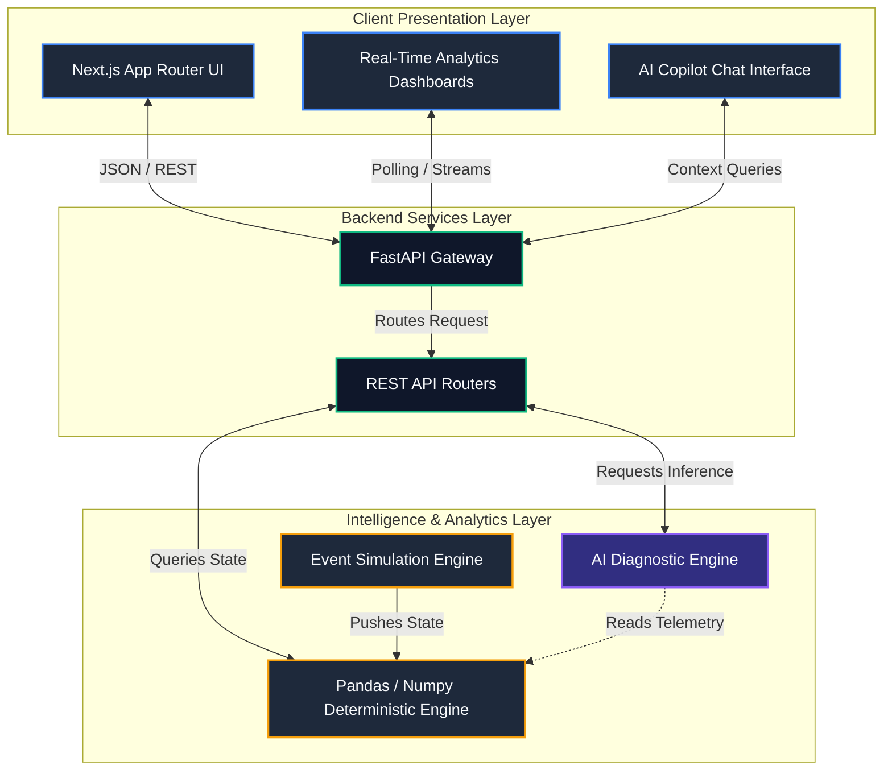

<div align="center">
  
  
  # RevGuard
  
  **Enterprise Campaign Health & Revenue Protection Platform**

  [](https://nextjs.org/)
  [](https://fastapi.tiangolo.com/)
  [](https://www.python.org/)
  [](https://www.typescriptlang.org/)
</div>

<br />

RevGuard is an AI-assisted telemetry and business intelligence platform designed for advertising operations and campaign management teams. It transforms disjointed, low-level technical signals (such as VAST errors, inventory shortages, and bidding timeouts) into **actionable, dollar-quantified business intelligence**.

By identifying delivery anomalies in real-time, estimating revenue-at-risk, and leveraging AI for root-cause diagnosis, RevGuard allows operations teams to catch and resolve campaign issues *before* they result in significant revenue loss.

---

## 📖 Table of Contents
- [The Problem](#-the-problem)
- [How RevGuard Solves It](#-how-revguard-solves-it)
- [System Architecture](#-system-architecture)
- [Core Capabilities](#-core-capabilities)
- [Technical Stack](#-technical-stack)
- [Local Development](#-local-development)

---

## 🛑 The Problem

In large-scale ad-operations, campaigns frequently underdeliver due to a myriad of technical and targeting issues:
- **Targeting Restrictions:** A campaign is restricted to Apple TV devices, but there is no available inventory.
- **Creative Errors:** VAST tags are throwing `HTTP 400` or media file timeouts.
- **Supply Constraints:** Yield issues on specific SSPs.

Typically, **these issues are discovered reactively**—only after pacing reports show a massive drop in delivery. AdOps managers must then manually dig through multiple disjointed systems (Google Ad Manager, log files, yield dashboards) to figure out *why* the campaign is failing. By the time the root cause is diagnosed, substantial revenue has already been lost.

---

## 💡 How RevGuard Solves It

RevGuard shifts campaign management from reactive to proactive:

1. **Continuous Monitoring:** Ingests live telemetry across all active campaigns.
2. **Anomaly Detection:** Statistically identifies when a campaign deviates from expected pacing and fill rates.
3. **Automated Diagnosis:** An AI engine correlates errors and logs to deduce the most probable root cause.
4. **Revenue Impact Quantification:** Calculates exactly how much money is bleeding out based on the campaign's CPM and impression gap.
5. **Actionable Recommendations:** Outputs a plain-English explanation and a direct recommendation (e.g., "Review Roku targeting settings" or "Replace faulty VAST tag").

---

## 🏗️ System Architecture

RevGuard utilizes a decoupled, modern architecture designed for high throughput and real-time responsiveness.



<div align="center">
  <h3>Animated System Architecture</h3>
  
</div>

### Component Breakdown
- **Presentation Layer (Frontend):** A rich, interactive Single Page Application (SPA) built on Next.js 14. It visualizes data using Recharts and manages state efficiently to ensure a non-blocking UI.
- **Backend Services (API):** A high-performance Python ASGI server utilizing FastAPI. It serves as the bridge between the UI and the data models.
- **Intelligence Layer:** 
  - *Deterministic Engine:* Uses Pandas and Numpy to process large arrays of campaign data, calculating deviations and revenue-at-risk.
  - *AI Engine:* Applies heuristic rules and LLM patterns to generate natural language explanations for technical failures.

---

## ✨ Core Capabilities

* **Business-Impact Triage:** The executive dashboard automatically ranks failing campaigns by **Revenue at Risk**, ensuring teams solve the most expensive problems first.
* **Natural Language Explanations:** Translates complex technical errors (e.g., "VAST Error 303") into operator-friendly summaries.
* **Guardian AI Copilot:** A context-aware assistant embedded in the application. Operators can ask questions like *"Why is the Acme Sports campaign failing?"* and receive immediate, data-backed answers.
* **One-Click Remediation:** (Simulated) Integrations with Atlassian Jira and Slack to instantly escalate issues to the engineering or yield teams.

---

## 🛠️ Technical Stack

- **Frontend Environment:** React, Next.js 14 (App Router)
- **Styling & UI:** Tailwind CSS, Radix UI (Primitives), Lucide React (Icons)
- **Data Visualization:** Recharts
- **Backend Environment:** Python 3.11+
- **API Framework:** FastAPI, Uvicorn, Pydantic (for strong type validation)
- **Data Processing:** Pandas, Numpy

---

## 🚀 Local Development

To run this project locally, you will need to start both the Python backend and the Next.js frontend.

### 1. Backend Setup (FastAPI)
The backend provides the API endpoints and the simulated telemetry data.

```bash
cd backend
python3 -m venv .venv
source .venv/bin/activate
pip install -r requirements.txt
uvicorn app.main:app --reload --host 127.0.0.1 --port 8000
```
*The API will be available at `http://localhost:8000`. You can view the interactive Swagger documentation at `http://localhost:8000/docs`.*

### 2. Frontend Setup (Next.js)
The frontend proxies requests to the local backend.

Open a new terminal window:
```bash
cd frontend
npm install
npm run dev
```

### 3. Usage
Navigate to **[http://localhost:3000](http://localhost:3000)** in your browser. The application is pre-configured to run in "Demo Mode" with a deterministic dataset for immediate exploration without requiring external API keys.
